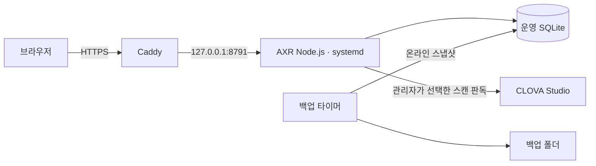

# 네이버 클라우드 AXR 배포



## 설치

1. 공인 IP가 있는 네이버 클라우드 Linux 서버를 준비합니다. 도메인의 DNS를 공인 IP로 연결합니다. ACG에서 TCP 80·443을 열고, SSH 22는 관리자 IP만 허용합니다. [네이버 클라우드 서버 가이드](https://guide.ncloud-docs.com/docs/en/server-procedure)
2. `axr` 시스템 사용자와 그룹을 만들고, 앱 소스를 `/opt/axr`에 둡니다. `package.json`이 지정한 Node.js와 npm 버전을 설치한 뒤 `npm ci`를 실행합니다. systemd 파일의 Node 경로는 `/usr/local/bin/node`입니다. 서버에서 다른 경로를 사용하면 unit 두 곳의 `ExecStart`를 맞춥니다.
3. root만 읽을 수 있는 `/etc/axr/operations.env` 파일을 만들고 다음 값을 설정합니다. 공개 접속 주소와 강한 데모 비밀번호를 지정해 데모 계정을 최초 초기화합니다.

   ```dotenv
   AXR_OPERATIONS_PUBLIC_ORIGIN=https://academy.example.com
   AXR_OPERATIONS_PORT=8791
   AXR_OPERATIONS_DB=/var/lib/axr/operations.sqlite
   AXR_BACKUP_DIR=/var/lib/axr/backups
   AXR_OPERATIONS_DEMO_PASSWORD=
   AXR_CLOVA_SCAN_ENABLED=false
   RAG_CLOVA_API_KEY=
   # 숙제 사진 문항 판독(CLOVA OCR General). 비워 두면 기존 판독 방식을 사용합니다.
   CLOVA_OCR_INVOKE_URL=
   CLOVA_OCR_SECRET=
   ```

4. `axr.service`, `axr-backup.service`, `axr-backup.timer`를 `/etc/systemd/system/`으로 복사합니다. Caddy를 설치하고 이 폴더의 `Caddyfile`을 적용합니다. Caddy 서비스에 `AXR_PUBLIC_HOST=academy.example.com`을 설정합니다. TLS가 발급되면 Node 서비스의 로컬 포트로 프록시됩니다.
5. 서비스와 타이머를 시작하고 상태를 확인합니다.

   ```sh
   sudo systemctl daemon-reload
   sudo systemctl enable --now axr.service axr-backup.timer
   sudo systemctl restart caddy
   sudo systemctl status axr.service axr-backup.timer
   sudo systemctl start axr-backup.service
   sudo journalctl -u axr-backup.service -n 10
   ```

SQLite 백업은 서버가 실행 중에도 일관된 스냅샷을 만들고, 무결성 검사를 통과하면 백업 폴더에 게시합니다. 복원 점검은 운영 파일과 분리된 경로에서 먼저 수행합니다. 백업은 기본적으로 서버의 로컬 디스크에 저장됩니다.

## 배포 확인

1. 데모 전용 DB의 첫 기동 후 기존 `scripts/prepare-qa-demo.ts`를 실행하면 회귀 질문에 필요한 가상 시간표와 보강 자료가 등록됩니다. 실행 사용자에게 데모 DB 쓰기 권한을 부여합니다.
2. `AXR_SMOKE_ORIGIN`에 HTTPS 주소, `AXR_SMOKE_DEMO_PASSWORD`에 데모 비밀번호를 설정하고 `node deploy/ncloud/smoke.mjs`를 실행합니다. 데모 계정 로그인, 네 반 시간표, 보강, 환불 부분 답변, 권한 거부, 근거 부족의 응답과 인용을 확인합니다.
3. 서버 재부팅 후 `systemctl status axr.service axr-backup.timer`를 확인하고 같은 테스트를 반복합니다.
4. 스캔 판독은 CLOVA 키와 `AXR_CLOVA_SCAN_ENABLED=true`를 서버 환경에 설정한 뒤 확인합니다. 관리자 자료 등록에서 개인정보가 없는 공개 자료로 PDF 또는 이미지를 올리고 CLOVA 판독에 동의합니다. 완료 후 검수 화면에서 표와 불일치 위치를 확인합니다. 주의 표시가 있는 경우 원본을 보고 새 개정판 본문을 수정한 뒤 승인합니다. 상담에는 승인된 개정판만 반영됩니다.

숙제 사진의 OCR 판독은 `CLOVA_OCR_INVOKE_URL`과 `CLOVA_OCR_SECRET`을 모두 설정해야 켜집니다. 값이 없어도 오류가 나지 않고 기존 판독 방식으로 동작하므로, 설정 후 숙제 등록에서 사진을 분석해 CLOVA OCR 도메인의 호출 기록을 확인합니다. 사진 채점(`/grading`)도 같은 두 값으로 문항 번호·영역을 찾고, 객관식 보기에 펜으로 표시한 답을 픽셀과 OCR 두 신호로 읽습니다. Cloudflare에서는 등록용 수학 문항의 이미지 영역을 Worker 이미지 처리기로 잘라 다시 읽습니다.

이 구성의 네이버 클라우드 배포와 재부팅은 아직 확인하지 않았습니다. 기존 [Cloudflare 배포 구성](../cloudflare/)은 예비 경로로 사용할 수 있습니다.
