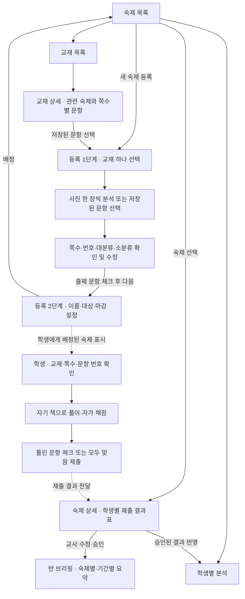

# 교재 숙제·승인·분석 기능 기획서

작성일은 2026년 11월 15일이며, 사용자 인터뷰에서 확정한 요구사항을 정리한 문서다. 구현할 목표 동작을 설명하며, 기존 코드의 구현 완료 여부는 별도 검증한다. 화면명은 인터뷰에서 사용한 이름을 따른다.

## 1. 목적과 작업 범위

교사는 교재 사진에서 문항 번호와 유형을 찾아 숙제를 구성한다. 학생은 자기 책으로 숙제를 풀고 직접 채점한 뒤 틀린 번호를 제출한다. 교사는 제출 결과를 확인·수정·승인하고, 승인된 결과로 반 브리핑과 학생별 분석을 확인한다.

| 작업 대상           | 역할                                            |
| ------------------- | ----------------------------------------------- |
| 숙제 목록           | 숙제 업무의 첫 화면. 배정·제출·승인 현황 확인   |
| 숙제 등록           | 문항 선택과 배정 설정을 두 단계로 진행          |
| 교재 목록           | 학원 공용 교재와 쪽수별 문항을 찾아 재사용      |
| 학생 숙제·오답 제출 | 교재·쪽수·번호를 확인하고 오답 번호 제출        |
| 숙제 상세           | 학생별 제출 결과를 한 표에서 수정·승인          |
| 반 브리핑           | 반에서 많이 틀린 문항과 다시 설명할 유형 확인   |
| 학생별 분석         | 특정 학생의 여러 숙제 결과를 기간·교재별로 조회 |

**기존 ‘학습 기록’은 팀원 담당 영역으로, 이번 작업에서 수정하지 않는다.** 학생별 분석은 별도 화면으로 만든다. 이 문서에서 정한 승인 절차는 이번 숙제·분석 흐름의 요구사항이다. 기존 학습 기록과 상담의 처리 방식 변경은 포함하지 않는다.

## 2. 화면 연결

실선은 사용 흐름이나 화면 이동을 나타낸다. 점선은 교사의 배정과 학생의 제출이 상대 화면에 반영되는 관계를 나타낸다.

## 3. 숙제 목록

교사가 숙제 메뉴를 열면 숙제 목록부터 보여준다. 숙제를 누르면 별도 상세 화면으로 이동한다.

목록에는 숙제 이름, 배정 대상, 마감일, 제출 현황, 승인 현황을 표시한다. 새 숙제 등록, 교재 목록, 학생별 분석으로 이동할 수 있게 한다.

아래 표는 화면 구성을 설명하는 예시다.

| 숙제               | 배정 대상 | 마감일 | 제출   | 승인   |
| ------------------ | --------- | ------ | ------ | ------ |
| 수학 11쪽 연습문제 | 수학 A반  | 11/20  | 8/10명 | 5/10명 |
| 영어 독해 2과      | 김민수    | 11/21  | 미제출 | 대기   |

## 4. 교재 목록과 문항 재사용

### 교재 정보

교재 이름은 직접 입력한다. 입력 중에는 기존 교재를 추천 목록으로 제공해 선택할 수 있게 한다. 학년·학기·개정판은 이름과 별도 항목으로 관리한다.

| 항목        | 용도                             |
| ----------- | -------------------------------- |
| 과목        | 수학·영어 구분 및 분류 기준 연결 |
| 교재 이름   | 교재 검색과 선택                 |
| 학년        | 교재 구분                        |
| 학기        | 교재 구분                        |
| 개정판 정보 | 같은 이름의 다른 판 구분         |

### 교재 조회와 공유

- 별도 교재 목록에서 교재를 선택한다.
- 교재 상세에서 관련 숙제와 쪽수별 문항을 확인한다.
- 저장된 문항을 선택해 새 숙제를 구성할 수 있다.
- 교재와 문항은 같은 학원의 강사들이 함께 사용한다.
- 문항 유형을 수정하면 공유 교재 목록에도 반영해, 이후 그 문항을 선택하는 강사도 수정된 유형을 사용한다.

한 숙제는 교재 하나로 구성한다. 같은 교재의 여러 쪽에서 문항을 선택할 수 있다. 서로 다른 교재의 문항을 한 숙제에 섞지 않는다.

## 5. 숙제 등록 1단계 — 문항 선택

### 사진 분석

사진을 올리는 목적은 문항 번호를 자동으로 찾고, 문항 유형을 분석하는 것이다. 이번 범위에서는 사진 한 장을 분석하고 다음 사진을 추가하는 방식을 사용한다.

- 쪽수는 AI가 찾아 채우고, 교사가 확인·수정한다.
- 인식된 문항 목록에서 출제할 문항을 체크한다.
- 문항 번호와 유형을 확인·수정한다.
- 누락된 문항은 교사가 번호와 기준서 유형을 직접 추가할 수 있다.
- 같은 교재의 다른 쪽 사진을 추가해 한 숙제의 문항을 모은다.
- 저장된 쪽수별 문항도 가져와 선택할 수 있다.

**원본 사진은 결과 확인 화면에 표시하지 않고 저장도 하지 않는다.** 교사는 손에 있는 교재와 대조한다. 사진은 분석 요청을 처리하는 데 사용하며, 원본을 다시 보여주기 위한 보관 기능을 두지 않는다.

### 문항 목록

| 출제      | 쪽수 | 문항 번호 | 대분류 | 소분류                 |
| --------- | ---- | --------- | ------ | ---------------------- |
| 선택      | 11   | 22        | 계산   | 식 정리                |
| 선택 해제 | 11   | 23        | 이해   | 개념·성질 파악 및 적용 |
| 선택      | 12   | 24        | 계산   | 공식·절차 수행         |

유형은 대분류와 소분류를 나눠 보여준다. **대분류를 선택하면 해당 대분류에 속한 소분류만 선택할 수 있다.** 유형 편집은 기준서 목록에서 선택·해제하는 방식이다.

기준서상 여러 유형이 필요한 문항에는 대분류·소분류 조합을 복수로 지정할 수 있게 한다. 출제할 문항을 고른 뒤 ‘다음’으로 배정 설정에 이동한다.

## 6. 숙제 등록 2단계 — 배정 설정

| 항목         | 동작                                    |
| ------------ | --------------------------------------- |
| 숙제 이름    | 교사가 직접 입력                        |
| 배정 대상    | 반 전체 또는 학생 개별 배정             |
| 여러 반 배정 | 같은 숙제를 여러 반에 한 번에 배정 가능 |
| 마감 날짜    | 필수 입력                               |
| 마감 시간    | 선택 입력                               |

배정한 뒤에는 반별 제출·승인 현황과 브리핑을 확인할 수 있게 한다. 마감 후에도 학생 제출을 허용하고 지각 제출로 표시한다.

시간을 생략하면 해당 날짜가 끝날 때를 마감으로 삼는 방식을 인터뷰 중 제안했다. 실제 적용 시간대와 경계 시각은 아래의 세부 확인 항목에 기록한다.

## 7. 학생의 숙제 수행과 제출

학생에게 교재 이름·쪽수·문항 번호를 보여준다. 학생은 자기 책으로 문제를 풀고 직접 채점한다.

1. 배정된 숙제를 연다.
2. 틀린 문항만 체크한다.
3. 전부 정답이면 ‘모두 맞음’을 선택한다.
4. 결과를 제출한다.

학생은 제출 후 결과를 수정할 수 없다. 이후 오답 번호 수정은 교사가 수행한다. 마감이 지난 제출에는 지각 제출 상태를 표시한다.

## 8. 숙제 상세 — 교사 확인과 승인

숙제를 선택하면 상세 화면으로 이동한다. 상단에는 숙제와 배정 문항 정보를, 아래에는 학생별 제출 결과표를 두는 구상이다.

| 학생   | 제출 상태 | 오답 번호  | 승인 상태 |
| ------ | --------- | ---------- | --------- |
| 김민수 | 제출 완료 | 22, 25, 28 | 승인 대기 |
| 이지우 | 지각 제출 | 23, 26     | 승인 대기 |
| 박서준 | 미제출    | —          | —         |

- 교사는 한 표에서 학생별 오답 번호를 확인한다.
- 학생이 잘못 체크한 번호를 교사가 직접 수정할 수 있다.
- 학생 한 명을 개별 승인하거나, 확인한 학생 여러 명을 선택해 일괄 승인할 수 있다.
- **교사가 승인한 결과만 반 브리핑과 학생별 분석에 반영한다.**

제출 여부, 지각 여부, 승인 여부는 각각 구분해 표시한다. 예를 들어 지각 제출한 학생도 교사가 결과를 승인할 수 있다.

## 9. 반 브리핑

반 브리핑은 교사가 수업 전에 반 전체의 결과를 보고 다시 설명할 내용을 정하는 화면이다.

### 조회 범위

- 특정 숙제 하나를 선택해 조회한다.
- 기간을 선택해 해당 반의 여러 숙제 결과를 합산한다.

### 우선 표시할 내용

- 반 전체의 결과 요약과 정답률
- 많이 틀린 문항
- 다시 설명할 대분류·소분류 유형

학생별 상세 분석은 별도 학생별 분석 화면에서 다룬다. 브리핑 집계에는 승인된 결과를 사용한다.

## 10. 학생별 분석

학생별 분석은 교사·관리자만 사용하는 별도 화면이다. 기존 ‘학습 기록’ 화면은 수정하지 않는다.

| 필터 | 조회 방식                          |
| ---- | ---------------------------------- |
| 학생 | 분석할 학생 선택                   |
| 과목 | 수학·영어 선택                     |
| 기간 | 여러 숙제를 합산할 기간 선택       |
| 교재 | 전체 교재 합산 또는 특정 교재 선택 |

선택한 범위의 전체 정답률과 유형별 결과를 표시한다. **대분류와 소분류 결과는 처음부터 모두 표시**한다. 대분류를 눌러야 소분류가 나타나는 방식으로 구성하지 않는다.

## 11. 문항 유형과 집계 기준

다음 두 기준서의 정의·포함·제외·보류 규칙을 따른다.

- [수학 숙제 문항 행동영역 판정 기준서](../src/features/question-classification/rubrics/math-behavior-rubric.md)
- [영어 숙제 문항 평가 요소 판정 기준서](../src/features/question-classification/rubrics/english-behavior-rubric.md)

### 수학

| 대분류    | 소분류                                                          |
| --------- | --------------------------------------------------------------- |
| 계산      | 식 정리, 공식·절차 수행                                         |
| 이해      | 수학적 표현 해석, 개념·성질 파악 및 적용, 수학적 표현 구성·변환 |
| 추론      | 규칙 발견·일반화, 조건에서 새 관계 도출, 명제 판단·증명         |
| 문제 해결 | 여러 개념 연결, 중간 목표 설정, 실제 상황에 수학 적용           |

독립적으로 중요한 핵심 행동이 여러 개일 때 복수 유형을 붙인다. 풀이 중 부수적으로 수행한 계산 등을 별도 핵심 유형으로 추가하지 않는다.

### 영어

| 대분류           | 소분류                                                                             |
| ---------------- | ---------------------------------------------------------------------------------- |
| 중심 내용 파악   | 주제·요지·제목 찾기                                                                |
| 세부 정보 파악   | 명시된 정보 확인                                                                   |
| 함축적 의미 추론 | 표현의 숨은 뜻 추론                                                                |
| 맥락 파악        | 목적·의견·주장 파악, 심경·분위기 파악, 문맥으로 빈칸 내용 추론                     |
| 간접 말하기      | 상황에 맞는 응답 선택                                                              |
| 간접 쓰기        | 문장 삽입, 글의 순서 배열, 흐름에서 벗어난 문장 찾기, 문단 구성에 맞춘 요약문 완성 |
| 언어형식·어휘    | 어법 판단, 문맥 속 어휘 판단, 지칭 대상 찾기                                       |

발문이 요구하는 핵심 행동을 기준으로 분류한다. 독립된 두 과제를 함께 채점하고 각각의 요구가 원문에 있을 때 복수 유형을 기록한다. 현재 영어 기준서의 적용 범위는 고등학교 수능형 영어 숙제다. 기준 밖 과제에 임의로 유형을 붙이지 않는다.

### 공통 집계 원칙

- 근거가 부족한 유형은 보류하고 유형별 집계에서 제외한다.
- 여러 유형이 붙어도 전체 숙제 문항 수에서는 한 번만 센다.
- 오답 번호로 확인한 결과와 실제 풀이에서 발생한 실수의 원인을 구분한다. 오답 번호만으로 사고 과정이나 원인을 단정하지 않는다.
- 재사용하는 문항의 유형과, 과거에 배정한 숙제의 유형 기록을 구분해 과거 결과가 조용히 바뀌지 않게 한다. 과거 기록 유지 방식은 인터뷰 중 제안한 기본값이다.

## 12. 보관할 정보

아래는 기능에 필요한 정보 관계이며, 실제 DB 테이블과 컬럼 설계는 구현 시 정한다.

| 정보      | 주요 내용                                                    |
| --------- | ------------------------------------------------------------ |
| 교재      | 학원, 과목, 이름, 학년, 학기, 개정판                         |
| 교재 문항 | 교재, 쪽수, 문항 번호, 대분류·소분류                         |
| 숙제      | 교재 하나, 직접 입력한 숙제 이름, 선택 문항, 배정 대상, 마감 |
| 학생 제출 | 제출 시각, 선택한 오답 번호, 지각 여부                       |
| 교사 확인 | 교사가 수정한 오답 번호, 승인 상태                           |

원본 사진은 보관 대상에서 제외한다. 공유 범위는 같은 학원이며, 분석 결과를 재사용해 같은 문항을 선택할 때 반복 사진 분석을 줄인다.

## 13. 추후 개선과 세부 확인 항목

### 추후 개선으로 남긴 사항

여러 장을 한꺼번에 올려 분석하는 기능은 추후 개선 항목이다. 이번에는 한 장씩 분석·추가하는 흐름을 사용한다. OCR 또는 모델 교체, 반복 판독 횟수 변경과 비용 최적화는 별도 검증 후 결정한다.

### 인터뷰에서 아직 확정하지 않은 사항

아래 항목은 필수 요구사항으로 추가한 것이 아니며, 구현 중 해당 동작을 정할 때 확인할 목록이다.

- 기존 ‘구간’ 입력 필드의 유지·삭제 여부
- 교재 학년·학기·개정판 정보의 필수 입력 여부와 같은 교재 판별 규칙
- 마감 시간 생략 시 적용할 시간대와 정확한 경계 시각
- 기간별 분석에서 기간을 나누는 기준 날짜
- 같은 교재·쪽수·번호를 다시 분석했을 때 기존 문항을 갱신하는 절차
- 이미 승인한 결과를 다시 수정할 때의 승인 처리 방식
- 기존 학습 기록의 내부 데이터 처리와 새 기능의 연결 범위

## 14. 구현 후 확인할 흐름

1. 교재 이름 입력 시 기존 교재가 추천되고, 학년·학기·개정판을 별도로 구분할 수 있는지 확인한다.
2. 사진 한 장씩 쪽수·번호·유형을 찾고, 누락 문항을 직접 추가할 수 있는지 확인한다.
3. 대분류를 바꾸면 해당 소분류만 선택 가능하고, 기준서상 필요한 복수 유형을 지정할 수 있는지 확인한다.
4. 한 교재의 여러 쪽에서 선택한 문항이 등록 2단계까지 유지되는지 확인한다.
5. 여러 반 또는 학생 개별 배정, 필수 날짜·선택 시간과 지각 제출이 의도대로 작동하는지 확인한다.
6. 학생 제출 후 교사 표에 결과가 나타나고, 수정·개별 승인·일괄 승인을 할 수 있는지 확인한다.
7. 승인 전 결과가 브리핑과 학생별 분석에서 제외되고, 승인 후 반영되는지 확인한다.
8. 반 브리핑의 숙제별·기간별 결과와 학생별 분석의 과목·교재별 결과가 실제 제출·승인 기록과 일치하는지 확인한다.
9. 교재 문항 수정이 이후 선택에 반영되는지 확인하고, 과거 숙제 기록 유지 기본값을 검증한다.
10. 원본 사진이 표시·보관되지 않고, 기존 학습 기록의 화면과 동작이 유지되는지 확인한다.
