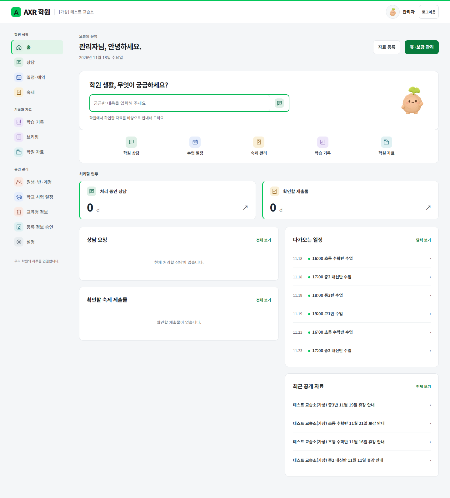
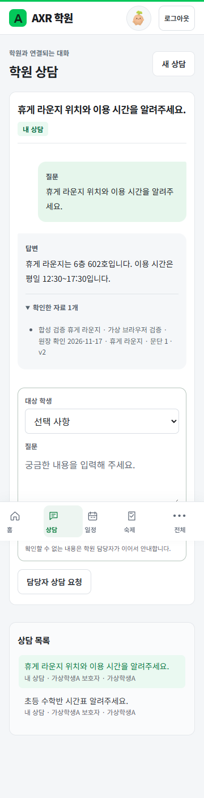

# 네이버 상담·화면 개선 검증 — 2026-11-17

운영 AI를 CLOVA Studio HCX-007로 전환하고, 일반 공개 문서에서 질문한 항목별 원문을 선택하도록 수정했다. 복합 질문의 일부 근거가 없으면 부분 답변 또는 보류로 처리한다. 학원·학생 권한, 대상 확인, 정형 사실과 기존 표·기간 조회를 먼저 수행한다. 이 보고서의 수치는 합성 문서에 대한 자동 평가이며 전체 실제 상담의 정확도 또는 무인 운영 가능성을 뜻하지 않는다.

기준 코드: `a864c7d99782a923f5b65eb05e4191697ff94221`. 엔진 1,036문항 평가 코드: `f625e74178413683affaa06101b7d7c8deeb4281`. 운영 검색 경로 수정 후 60/40문항·웹 평가 코드: `6b6627e5556afbfd571e87e390435ac1bd732980`. 이후 변경은 설명·평가 기록이다. 평가 정답, 기존 질문, 필수·금지 문자열을 바꾸지 않았다. 최종 코드의 결과·질문·실제 답변·인용·실패 조건은 [results.json](results.json)에 보존했다.

## 1. 고친 원인과 처리

- 보호자에게 반이 등록되어 있다는 이유만으로 `언제` 같은 일반 의문사를 시간표 조건으로 취급하던 경로와 `반납`의 `반`을 반 지칭으로 보던 경로를 수정했다. 반·과목·수업을 실제로 가리키는 조건과 일반 공용 안내를 분리했다.
- 일반 문서의 제목·주제 일치만으로 관련 문장을 답으로 채택하거나 복합 질문 일부만 답하던 경로를 보강했다. 기존 대상 확인·권한 거부를 먼저 수행하고 일반 문서 해석 후보만 CLOVA에 전달한다.
- 서버가 원질문과 요구 구절을 함께 보관한다. 구조화 출력의 요청 구절 집합·개수·중복·질문 원문을 검사한다. 설명 이유로 붙은 문장을 별도 미답 질문으로 분리하지 않도록 처리했다. 구절 분리는 한국어의 모든 중의성을 해결하는 완전한 형태소·의미 분석기는 아니다.
- 모델은 자유 답변 대신 각 요구에 대한 `complete`, 원문 `quote`, 실제 `sourceId`를 선택한다. 주제만 유사한 문장은 근거로 쓰지 않도록 지시한다. 문서 원문과 일치하지 않는 인용, 임의 출처, 빠진 요구는 거부한다.
- 조건·부정이 떨어지지 않도록 선택한 문장이 들어 있는 원문 행을 표시하고, 마지막 단계에서 승인·권한·개정판·수치·인용 위치를 재확인한다. 일부 확인은 `partial`, 모두 미확인은 `abstained`다.
- 이미 대상을 정한 반·학생, 정형 사실, 표 셀, 회차·차량·기간·공지의 전용 조회는 유지한다. 공개 안내 AI는 개인/반 귀속 자료·표·불확실 OCR을 제외한다. 표 답변과 2열 공통 규정은 기존 행·열 검증 경로에서 처리한다. 기존 후보 출처도 함께 읽어 재검색의 용어 확장으로 좋은 근거가 밀려나지 않게 했다.
- 운영은 네이버 API만 호출한다. 입력은 최대 16개 청크·청크당 2,400자로 제한하고 요청별 자동 재시도는 하지 않는다. `Gemini` 환경값이 남아 있어도 Google로 전환하지 않는다. 기존 Google 어댑터와 과거 시험 기록은 재현용으로만 보존했고 운영 중계 Worker 코드·연결을 제거했다. 실제 개인정보는 기본 외부 전송 차단 설정을 유지했다.
- UTC 일자당 기본 100건의 상담 호출 상한을 SQLite에 기록해 서버 재시작으로 초기화되지 않게 했다. 네트워크 실패도 한 건으로 센다. 호출 상한은 원화 과금 상한이 아니며 계정의 실제 청구액은 확인하지 않았다.

구조화 출력은 형식을 강제할 뿐 의미적 정답을 보증하지 않는다. 원문 존재 검사는 인용 위조를 막지만, 인용한 문장이 질문의 모든 조건을 충족하는지는 모델 오판이 남을 수 있다. 이번 평가에서 이를 자동 판정이 완벽하게 검출한다고 주장하지 않는다.

## 2. 문항 구성·채점 기준

| 세트           | 문항 수 | 선정·용도                                                                                                                                                               |
| -------------- | ------: | ----------------------------------------------------------------------------------------------------------------------------------------------------------------------- |
| 기존 운영 질문 |      60 | 주소·시간·환불·납부·결석·주차 등 36개, 복합 8개, 근거 없음 8개, 권한 8개. 이전 40/60과 동일 정의로 비교                                                                 |
| 새 공개 안내   |      40 | 휴게 공간·귀가 동행·인쇄·우산·출입증·자전거·택배·주말 상담의 새 합성 문서 8개. 단일 16개, 전부 답할 수 있는 복합 10개, 일부 근거 없는 복합 4개, 근거 없음 6개, 권한 4개 |
| 기존 엔진 회귀 |   1,036 | 90 + 표현 변형 100 + 개발 153 + 공개 평가 393 + 구조 회귀 300. 이미 공개된 자료이며 새 독립 평가가 아님                                                                 |

새 40문항은 첫 API 호출 전 [정의 파일](../../scripts/fixtures/naver-public-cases.json)을 고정했다. SHA-256 `545ea070723d66691b0f6a0a4c872777d4cb4d695ba2922dff4a9827abb89a4c`. 기존 60문항 SHA-256 `bf5074710e6c4b13217e26a8e2b592f4b164bc908946f74b868aefef41a57438`. 40문항 첫 실행과 수정 후 반복 실행을 분리한다. 반복 실행 점수를 새 독립 성능으로 계산하지 않는다.

운영 60/40문항은 문서 초안 등록 → 승인 개정판 생성 → 운영 상담 요청 → 검색·답변·최종 인용 → DB에 저장된 결과 조회 흐름으로 실행했다. 테스트마다 임시 DB를 사용했다. 실제 CLOVA 요청을 사용하며 정답 주입·Mock 응답은 사용하지 않았다. 권한·정형 조회로 해결되는 질문은 AI를 호출하지 않는다.

`service-claims-v2` 문항 통과는 다음 조건을 모두 만족해야 한다.

1. 기대 상태 집합과 최종 상태가 일치한다. 답변 가능은 `answered`, 일부 근거는 `partial`, 근거 없음은 `abstained`, 권한 밖 요청은 `denied` 또는 메시지 생성 없이 HTTP 403이다. `clarify`와 `handoff`를 답변 성공으로 임의 변환하지 않는다.
2. 요구된 필수 내용이 NFKC·공백 정규화 후 **모두** 포함된다.
3. 요구된 근거 문서가 **모두** 인용되고 승인 개정판 2와 실제 위치 정보가 있다. 한 문서만 인용해도 되는 OR 조건으로 바꾸지 않는다.
4. 근거를 제공할 수 없는 질문에는 인용이 없어야 한다. 권한 거부가 DB에 상담 답변을 남기지 않았는지도 확인한다.

이 기준은 의미 전체를 이해하는 자동 심판이 아니다. 필수 문자열 외 추가 주장, 모든 조건의 논리적 함의, 사소한 표현의 자연스러움을 전부 채점하지는 못한다. 원문 일치·권한·개정판 검사와 별도 보안 회귀 테스트로 보완한다.

기존 1,036문항은 원래 평가기와 정답을 그대로 유지했다. 사전 정의된 API 장애 17문항은 기존 모의 장애 주입을 유지했으며 실제 HTTP 호출 성공으로 세지 않았다. 그 평가기는 일부 세트에서 대체 가능한 출처 중 하나와 호출 예산도 함께 채점한다. 따라서 아래의 **기존 채점**과 **내용·출처 조건**은 다른 지표다. 후자는 기존 checks 중 생성 횟수 조건만 별도 집계하며 상태·내용·인용·위반 검사는 유지한다. 더 강한 새 의미 평가 점수라고 부르지 않는다.

## 3. 실제 결과

| 운영 평가   | 수정 전 |    첫 새 검증 | 최종 코드 재실행 | 최종 실제 네이버 호출 | HTTP 실패 |
| ----------- | ------: | ------------: | ---------------: | --------------------: | --------: |
| 동일 60문항 |   40/60 |     해당 없음 |    57/60 (95.0%) |                    48 |         0 |
| 새 40문항   |   12/40 | 38/40 (95.0%) |    39/40 (97.5%) |                    36 |         0 |

60문항 최종 p50/p95는 2.76/5.16초, 40문항은 3.21/5.13초다. 호출 사이 대기 시간은 질문 응답 시간에 포함하지 않았다. 실행 장비·네트워크의 값이며 운영 SLA가 아니다.

| 기존 세트         | 기준 Mock 채점 | 최종 실제 CLOVA 기존 채점 | 최종 내용·출처 조건 | 실제 호출 |
| ----------------- | -------------: | ------------------------: | ------------------: | --------: |
| v1-90             |          90/90 |                     83/90 |               88/90 |         8 |
| v1-paraphrase-100 |        100/100 |                   100/100 |             100/100 |        10 |
| v2-AC_ARCH_1      |        100/100 |                   100/100 |             100/100 |         0 |
| v2-AC_ARCH_2      |        100/100 |                   100/100 |             100/100 |         0 |
| v2-AC_ARCH_3      |        100/100 |                   100/100 |             100/100 |         0 |
| v2-dev            |        152/153 |                   146/153 |             151/153 |         6 |
| v2-test           |        384/393 |                   367/393 |             380/393 |        19 |
| 합계              |    1,026/1,036 |                 996/1,036 |          1019/1,036 |        43 |

Mock과 실제 모델은 동등한 비교 조건이 아니다. 특히 승인된 지도 방법이 없는 학습 상담은 Mock이 통과해도 실제 모델은 보류/담당자 연결될 수 있다. 기존에 정답이던 문항 중 내용·출처 조건에서 실패한 ID: `GA-018`, `SS-021`, `HK-D-041`, `HK-D-134`, `NR-T-053`, `OS-T-002`, `OS-T-118`, `SD-T-009`, `SD-T-010`, `SD-T-041`. 반대로 이전 실패에서 해당 조건을 통과한 ID: `HK-D-045`, `NR-T-044`, `SD-T-045`. 원래 실패와 새 실패는 results.json에서 구분한다. 예산 조건만 실패한 문항을 실제 내용 오류로 합산하지 않되 원래 총점에서도 제거하지 않았다.

운영 60/40 최종 미통과:

- `address-2`: 학원 어디로 가면 돼요? — status, claim:새마루로73, claim:4층, source:address
- `refund-3`: 환급은 어떻게 신청하고 며칠 걸려요? — status, claim:방문, claim:5영업일, source:refund
- `absence-3`: 결석 신청 기한과 방법은? — status
- `partial-4`: 주말 상담 시간과 상담 담당자 이름 알려줘. — status, claim:10:00, claim:14:00, source:weekend

실제 60/40문항의 [모델 선택 JSON](model-selections.json)도 보존한다. API 키와 요청 헤더는 저장하지 않았다. `address-2`, `refund-3`은 모델이 ambiguous=true로 판단했고, `absence-3`은 방법 원문에 기한도 포함되어 있지만 기한 요구를 complete=false로 판정했다. 이를 검색 실패나 API 장애로 임의 분류하지 않는다.

## 4. 시험 중 발견하고 채택하지 않은 방식

- 일반 문서를 무조건 AI로 덮어쓰는 방식: 자녀 확인·강사 개인 연락처 정책과 기존 표 선택을 우회했다. 채택하지 않고 기존 판정 후 필요한 공개 문서만 읽도록 순서를 바꿨다.
- 일반 공개 문서의 전문 규칙 답변을 무조건 유지하는 방식도 60문항 48/60, 새 40문항 재실행 32/40으로 누락이 남았다. 주소와 주차를 함께 묻는데 주차만 답하는 조기 반환이 원인이어서, 권한·대상·정형 근거를 제외한 공개 안내는 전체 요구를 다시 확인하도록 고쳤다.
- 검색 결과에 표가 하나라도 있으면 AI를 건너뛰는 방식: 무관한 표 때문에 실제 웹에서 AI가 한 번도 호출되지 않았다. 제거하고 실제 선택 근거·표 축으로 판단했다.
- 임시 숫자로 출처 ID를 치환하는 방식: 기존 안전 평가에서 알 수 없는 출처로 기록됐다. 실제 sourceId를 유지하고 원문·개정판으로 검증했다.
- AI가 일반 2열 표까지 자유롭게 선택하는 방식: 자습실 질문에 값이 우연히 같은 학원 운영 표를 인용한 사례가 나왔다. AI 입력에서 표를 제외하고 기존 셀 선택·검증 경로에서 처리하도록 분리했다.
- 전체 청크를 답변에 복사하는 방식: 질문과 무관한 항목이 섞였다. 인용한 문장이 들어 있는 원문 행으로 출력 범위를 줄였다.
- 동시 실제 API 평가: 60문항은 32/60, 40문항은 24/40으로 내려갔고 각각 429 응답 2건/1건이 발생했다. 장애 후 보류가 뒤 문항까지 영향을 준 결과다. 이 실패를 숨기지 않고 최종 정확도 재검증을 순차 실행했다. 운영의 집중 요청 상황도 별도로 관리해야 한다.
- 새 Dense/Reranker·다른 모델·생성 다중 호출은 추가하지 않았다. 이번 병목은 이미 찾은 자료의 요구 누락·근거 연결·라우팅 순서였고, 검색 모델 변경만으로 이를 해결할 근거가 없었다.

## 5. 화면·회귀 검증

네이버 계열 서비스의 검색 중심 진입, 간결한 메뉴, 녹색 강조, 목록 중심 구성을 참고했다. 원래 캐릭터를 유지했다. 홈 질문을 상담 초안으로 전달하고, 추천 질문은 수정 가능한 입력으로 넣는다. 상담 답변과 원문 근거를 나누고, 처리 중 상태와 중복 전송 방지, 모바일 하단 탐색을 적용했다. NDK를 설치한 것으로 표현하지 않으며 로고·서비스 자산을 복제하지 않았다.

- 자동 테스트: 730개 통과, 실패·건너뜀 0개. 기존 테스트를 삭제하거나 비활성화하지 않았다.
- lint·TypeScript·Prettier 통과. Next 프로토타입 빌드와 별도로 실제 운영 Cloudflare 묶음 생성 및 dry-run을 확인했다.
- 역할 5종, 39개 화면을 1440/390/360px에서 확인: 총 117개 페이지 응답·가로 넘침·스크립트 오류 검사.
- 모바일 39개 화면의 axe 접근성 검사 위반 0건. 자동 검사의 범위이며 모든 접근성을 보증하지 않는다.
- 홈 질문 전달·추천 질문 편집·모바일 메뉴·권한 메뉴·로그아웃·공개 자료 인용·오프라인 민감 HTML 저장 금지 등 9개 상호작용 확인.
- 실제 브라우저에서 새 합성 안내의 위치와 시간을 함께 질문하고 CLOVA 호출 1회, 답변 값·인용 펼침·지속 호출 카운터를 확인했다. 사용자 데스크톱 대신 분리된 테스트 브라우저를 사용했다.





## 6. 남은 한계·사용 범위

공개 안내와 정형 조회를 담당자가 보조적으로 사용하는 시범 운영에는 개선 근거가 있다. **무인 상담을 전면 맡길 수준으로 검증됐다고 판정하지 않는다.** 근거가 있어도 모델이 모호하다고 판단해 보류하거나, 복합 요구 일부를 놓칠 수 있다. 정답 문구·출처 검사만으로 모든 의미 오류를 잡지 못한다. 새 40문항의 95%를 실제 학원 전체의 95%로 일반화하지 않는다.

학습 방향 생성은 승인된 지도 근거가 없으면 담당자에게 연결한다. 기존 저품질 OCR·다축 표의 일부 실패가 남는다. 동시 요청량 제한과 일일 100건 상한이 있으므로 다수 학원의 운영 부하를 확인한 것은 아니다. 원화 청구액·장기 장애 복구·실제 휴대폰 APK 동작은 이번 측정 대상이 아니다. 인증된 웹에서의 실제 CLOVA 호출 검증은 임시 로컬 서버에서 수행했으며, Cloudflare 배포 환경에 로그인한 뒤 모델 응답까지 확인한 결과와 구분한다. 사진 AI는 기존 네이버 연결을 유지했으며 음성 서비스는 별도 Speech/Voice 자격 증명이 없으면 비활성이다.

## 7. 재현·자료

```powershell
npm run check
npm test
node scripts/verify-service-chat.ts --out .local/naver60
node scripts/verify-service-chat.ts --definition scripts/fixtures/naver-public-cases.json --out .local/naver40
node scripts/verify-service-browser.mjs --out .local/naver-browser --live-public
```

서버 환경에 RAG_CLOVA_API_KEY를 안전하게 설정해야 실제 요청된다. 평가 동시 실행을 피하고 `AXR_EVAL_INTERVAL_MS=5000`을 권장한다. 원래 평가 1,036문항은 run-eval.ts의 `--suite v1-90,v1-paraphrase-100,v2-dev,v2-test,v2-AC_ARCH_1,v2-AC_ARCH_2,v2-AC_ARCH_3 --variant engine-planned --generation clova-synthetic --max-live-calls 100 --label finalized --out <미리 만든 폴더>`로 실행했다. synthetic 모드는 저장소의 가상 데이터만 허용하며 운영 개인정보 설정을 바꾸지 않는다.

- [CLOVA v3 구조화 출력 공식 문서](https://api.ncloud-docs.com/docs/clovastudio-chatcompletionsv3-so)
- [CLOVA 호출 제한 공식 문서](https://guide.ncloud-docs.com/docs/clovastudio-ratelimiting)
- [사용자가 제시한 NDK 디자인 사례](https://newtype.design/works/article/ndk)
- [NAVER WORKS 모바일 메뉴 가이드](https://help.worksmobile.com/ko/admin-guides/settings/customize/mobile-app/)
